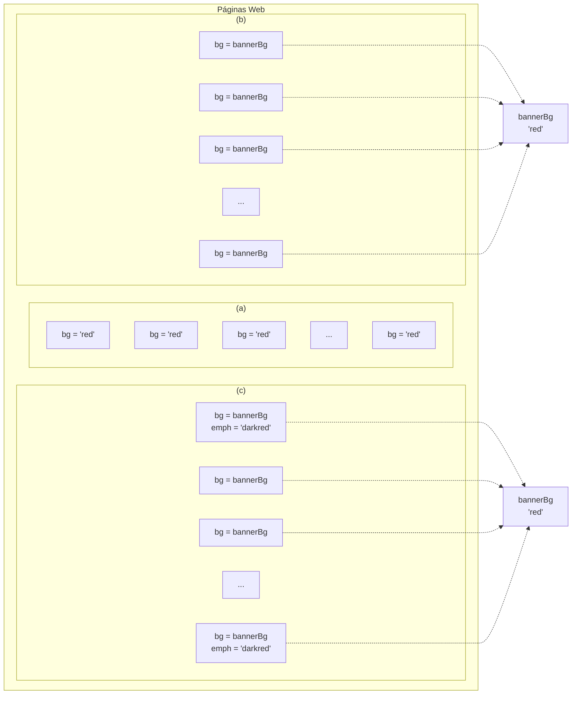

# Capítulo 2 — A Natureza da Complexidade

Este livro trata de como projetar sistemas de software para minimizar sua complexidade. O primeiro passo é entender o inimigo. O que exatamente é "complexidade"? Como saber se um sistema é desnecessariamente complexo? O que faz com que os sistemas se tornem complexos? Este capítulo abordará essas questões em alto nível; os capítulos subsequentes mostrarão como reconhecer a complexidade em um nível mais baixo, em termos de características estruturais específicas.

A habilidade de reconhecer a complexidade é uma competência crucial de design. Ela permite que você identifique problemas antes de investir muito esforço neles e possibilita fazer boas escolhas entre as alternativas. É mais fácil dizer se um design é simples do que criar um design simples, mas, uma vez que você consiga reconhecer que um sistema está muito complicado, pode usar essa habilidade para guiar sua filosofia de design em direção à simplicidade. Se um design parecer complicado, tente uma abordagem diferente e veja se ela é mais simples. Com o tempo, você notará que certas técnicas tendem a resultar em designs mais simples, enquanto outras estão correlacionadas à complexidade. Isso permitirá que você produza designs mais simples com maior rapidez.

Este capítulo também estabelece algumas premissas básicas que fornecem uma base para o restante do livro. Os capítulos posteriores assumem o material deste capítulo como dado e o utilizam para justificar uma série de refinamentos e conclusões.

## 2.1 A definição de complexidade

Para os propósitos deste livro, defino "complexidade" de uma maneira prática. A complexidade é qualquer aspecto relacionado à estrutura de um sistema de software que torne difícil entender e modificar o sistema. A complexidade pode assumir diversas formas. Por exemplo, pode ser difícil entender como um trecho de código funciona; pode exigir muito esforço para implementar uma pequena melhoria, ou pode não ficar claro quais partes do sistema precisam ser modificadas para realizar essa melhoria; pode ser difícil corrigir um bug sem introduzir outro. Se um sistema de software é difícil de entender e modificar, então ele é complicado; se é fácil de entender e modificar, então ele é simples.

Você também pode pensar na complexidade em termos de custo e benefício. Em um sistema complexo, dá muito trabalho implementar até mesmo pequenas melhorias. Em um sistema simples, melhorias maiores podem ser implementadas com menos esforço.

A complexidade é o que um desenvolvedor vivencia em um determinado momento ao tentar alcançar um objetivo específico. Ela não está necessariamente relacionada ao tamanho geral ou à funcionalidade do sistema. As pessoas costumam usar a palavra "complexo" para descrever sistemas grandes com recursos sofisticados, mas se for fácil trabalhar em um sistema assim, então, para os propósitos deste livro, ele não é complexo. É claro que quase todos os sistemas de software grandes e sofisticados são, de fato, difíceis de se trabalhar, de modo que também se enquadram na minha definição de complexidade, mas esse não precisa ser necessariamente o caso. Também é possível que um sistema pequeno e pouco sofisticado seja bastante complexo.

A complexidade é determinada pelas atividades que são mais comuns. Se um sistema tem algumas partes que são muito complicadas, mas essas partes quase nunca precisam ser alteradas, então elas não têm muito impacto na complexidade geral do sistema. Para caracterizar isso de uma forma matemática bruta:

$$C = \sum_{p} c_p t_p$$

A complexidade geral de um sistema ($C$) é determinada pela complexidade de cada parte $p$ ($c_p$) ponderada pela fração de tempo que os desenvolvedores passam trabalhando nessa parte ($t_p$). Isolar a complexidade em um lugar onde ela nunca será vista é quase tão bom quanto eliminá-la por completo.

A complexidade é mais evidente para quem lê do que para quem escreve. Se você escreve um trecho de código e ele parece simples para você, mas outras pessoas acham que é complexo, então ele é complexo. Quando você se deparar com situações como essa, vale a pena investigar com os outros desenvolvedores para descobrir por que o código parece complexo para eles; provavelmente há lições interessantes a serem aprendidas com essa divergência entre a sua opinião e a deles. O seu trabalho como desenvolvedor não é apenas criar um código com o qual você consiga trabalhar facilmente, mas sim criar um código com o qual os outros também possam trabalhar com facilidade.

## 2.2 Sintomas da complexidade

A complexidade se manifesta de três formas gerais, que são descritas nos parágrafos abaixo. Cada uma dessas manifestações torna mais difícil a execução de tarefas de desenvolvimento.

**Amplificação de mudanças:** O primeiro sintoma da complexidade é que uma alteração aparentemente simples exige modificações de código em muitos lugares diferentes. Por exemplo, considere um site contendo várias páginas, onde cada uma exibe um banner com uma cor de fundo. Em muitos sites antigos, a cor era especificada explicitamente em cada página, como mostrado na Figura 2.1(a). Para alterar o fundo de um site como esse, um desenvolvedor poderia ter que modificar manualmente todas as páginas existentes; isso seria quase impossível para um site grande com milhares de páginas. Felizmente, os sites modernos usam uma abordagem semelhante à da Figura 2.1(b), onde a cor do banner é especificada apenas uma vez em um local centralizado, e todas as páginas individuais fazem referência a esse valor compartilhado. Com essa abordagem, a cor do banner do site inteiro pode ser alterada com uma única modificação. Um dos objetivos de um bom design é reduzir a quantidade de código afetada por cada decisão de projeto, para que as alterações arquiteturais não exijam tantas modificações no código-fonte.

**Carga cognitiva:** O segundo sintoma da complexidade é a carga cognitiva, que se refere ao quanto um desenvolvedor precisa saber para concluir uma tarefa. Uma carga cognitiva mais alta significa que os desenvolvedores precisam gastar mais tempo aprendendo as informações necessárias, além de haver um risco maior de introduzirem *bugs* por terem deixado passar algo importante. Por exemplo, suponha que uma função em C aloque memória, retorne um ponteiro para essa memória e presuma que a função chamadora fará a liberação dessa memória. Isso aumenta a carga cognitiva dos desenvolvedores que utilizam a função; se um desenvolvedor esquecer de liberar a memória, ocorrerá um vazamento de memória (*memory leak*). Se o sistema puder ser reestruturado de forma que o chamador não precise se preocupar em liberar a memória (o mesmo módulo que aloca a memória também assume a responsabilidade de liberá-la), isso reduzirá a carga cognitiva. A carga cognitiva surge de várias formas, como em APIs com muitos métodos, variáveis globais, inconsistências e dependências entre módulos.

Os projetistas de sistemas às vezes pressupõem que a complexidade pode ser medida por linhas de código. Eles presumem que, se uma implementação é mais curta que outra, então ela deve ser mais simples; se são necessárias apenas algumas linhas de código para fazer uma alteração, então a alteração deve ser fácil. No entanto, essa visão ignora os custos associados à carga cognitiva. Já vi *frameworks* que permitiam escrever aplicações com apenas algumas linhas de código, mas era extremamente difícil descobrir o que essas linhas faziam. **Às vezes, uma abordagem que exige mais linhas de código é, na verdade, mais simples, porque reduz a carga cognitiva.**

**Figura 2.1:** Cada página em um site exibe um banner colorido. Em (a), a cor de fundo do banner é especificada explicitamente em cada página. Em (b), uma variável compartilhada armazena a cor de fundo e cada página faz referência a essa variável. Em (c), algumas páginas exibem uma cor adicional para dar ênfase, que é um tom mais escuro da cor de fundo do banner; se a cor de fundo mudar, a cor de destaque também deverá mudar.

**Incógnitas desconhecidas (*Unknown unknowns*):** O terceiro sintoma da complexidade é que não fica óbvio quais partes do código precisam ser modificadas para concluir uma tarefa, ou quais informações um desenvolvedor precisa ter para executá-la com sucesso. A Figura 2.1(c) ilustra esse problema. O site usa uma variável central para determinar a cor de fundo do banner, então parece ser fácil de alterar. No entanto, algumas páginas da web usam um tom mais escuro da cor de fundo para dar destaque, e essa cor mais escura é especificada explicitamente nas páginas individuais. Se a cor de fundo mudar, então a cor de destaque também deve mudar para corresponder a ela. Infelizmente, é improvável que os desenvolvedores percebam isso, de modo que podem acabar alterando a variável central `bannerBg` sem atualizar a cor de destaque. Mesmo que um desenvolvedor esteja ciente do problema, não será óbvio quais páginas usam a cor de destaque, então ele talvez precise procurar em todas as páginas do site.

Das três manifestações da complexidade, as incógnitas desconhecidas são as piores. Uma incógnita desconhecida significa que há algo que você precisa saber, mas não há como descobrir o que é, ou sequer se há algum problema. Você não descobrirá até que surjam *bugs* depois de fazer uma alteração. A amplificação de mudanças é irritante, mas, desde que fique claro qual código precisa ser modificado, o sistema funcionará assim que a mudança for concluída. Da mesma forma, uma alta carga cognitiva aumentará o custo de uma alteração, mas se estiver claro quais informações devem ser lidas, é provável que a alteração ainda seja correta. Com incógnitas desconhecidas, não fica claro o que fazer ou mesmo se uma solução proposta irá funcionar. A única maneira de ter certeza é ler todas as linhas de código do sistema, o que é impossível em sistemas de qualquer tamanho. Mesmo isso pode não ser suficiente, porque uma alteração pode depender de uma decisão sutil de design que nunca foi documentada.

Um dos objetivos mais importantes de um bom design é que um sistema seja *óbvio*. Isso é o oposto de alta carga cognitiva e incógnitas desconhecidas. Em um sistema óbvio, um desenvolvedor consegue entender rapidamente como o código existente funciona e o que é necessário para fazer uma alteração. Um sistema óbvio é aquele onde um desenvolvedor consegue dar um palpite rápido sobre o que fazer, sem pensar muito, e ainda assim ter a confiança de que o palpite está correto. O Capítulo 18 discute técnicas para tornar o código mais óbvio.

## 2.3 Causas da complexidade

Agora que você conhece os sintomas de alto nível da complexidade e por que ela dificulta o desenvolvimento de software, o próximo passo é entender o que causa a complexidade, para que possamos projetar sistemas que evitem esses problemas. A complexidade é causada por duas coisas: *dependências* e *obscuridade*. Esta seção discute esses fatores em alto nível; os capítulos subsequentes discutirão como eles se relacionam com as decisões de design de baixo nível.

Para os propósitos deste livro, uma dependência existe quando um determinado trecho de código não pode ser compreendido e modificado isoladamente; o código se relaciona de alguma forma com outro código, e o outro código deve ser considerado e/ou modificado se o código em questão for alterado. No exemplo do site da Figura 2.1(a), a cor de fundo cria dependências entre todas as páginas. Todas as páginas precisam ter o mesmo fundo, então, se o fundo for alterado para uma página, ele deverá ser alterado para todas elas. Outro exemplo de dependências ocorre em protocolos de rede. Normalmente, há códigos separados para o remetente e o destinatário do protocolo, mas cada um deles deve estar em conformidade com o protocolo; alterar o código do remetente quase sempre exige mudanças correspondentes no destinatário e vice-versa. A assinatura de um método cria uma dependência entre a implementação desse método e o código que o invoca: se um novo parâmetro for adicionado a um método, todas as invocações desse método devem ser modificadas para especificar esse parâmetro.

As dependências são uma parte fundamental do software e não podem ser completamente eliminadas. Na verdade, introduzimos dependências intencionalmente como parte do processo de design de software. Toda vez que você escreve uma nova classe, você cria dependências em torno da API dessa classe. No entanto, um dos objetivos do design de software é reduzir o número de dependências e tornar as dependências que restam as mais simples e óbvias possíveis.

Considere o exemplo do site. No site antigo, com o fundo especificado separadamente em cada página, todas as páginas da web dependiam umas das outras. O novo site corrigiu esse problema especificando a cor de fundo em um local central e fornecendo uma API que as páginas individuais usam para recuperar essa cor quando são renderizadas. O novo site eliminou a dependência entre as páginas, mas criou uma nova dependência em torno da API para recuperar a cor de fundo. Felizmente, a nova dependência é mais óbvia: fica claro que cada página da web individual depende da cor `bannerBg`, e um desenvolvedor pode encontrar facilmente todos os lugares onde a variável é usada pesquisando pelo seu nome. Além disso, os compiladores ajudam a gerenciar dependências de API: se o nome da variável compartilhada mudar, ocorrerão erros de compilação em qualquer código que ainda use o nome antigo. O novo site substituiu uma dependência não óbvia e difícil de gerenciar por uma mais simples e óbvia.

A segunda causa da complexidade é a obscuridade. A obscuridade ocorre quando informações importantes não são óbvias. Um exemplo simples é o nome de uma variável que é tão genérico que não traz muitas informações úteis (por exemplo, `time` [N.T.: traduzido geralmente como "tempo" ou "hora"]). Ou a documentação de uma variável pode não especificar suas unidades, então a única maneira de descobrir é escanear o código em busca de lugares onde a variável é usada. A obscuridade costuma estar associada a dependências, onde não é óbvio que uma dependência exista. Por exemplo, se um novo status de erro for adicionado a um sistema, pode ser necessário adicionar uma entrada a uma tabela que contém mensagens de texto para cada status, mas a existência da tabela de mensagens pode não ser óbvia para um programador olhando para a declaração do status. A inconsistência também é um grande contribuinte para a obscuridade: se o mesmo nome de variável for usado para dois propósitos diferentes, não será óbvio para os desenvolvedores a qual desses propósitos uma determinada variável atende.

Em muitos casos, a obscuridade surge devido à documentação inadequada; o Capítulo 13 trata desse tópico. No entanto, a obscuridade também é uma questão de design. Se um sistema tiver um design limpo e óbvio, ele precisará de menos documentação. A necessidade de documentação extensa costuma ser um alerta vermelho de que o design não está muito adequado. A melhor maneira de reduzir a obscuridade é simplificando o design do sistema.

Juntas, as dependências e a obscuridade respondem pelas três manifestações de complexidade descritas na Seção 2.2. As dependências levam à amplificação de mudanças e a uma alta carga cognitiva. A obscuridade cria incógnitas desconhecidas (unknown unknowns) e também contribui para a carga cognitiva. Se conseguirmos encontrar técnicas de design que minimizem as dependências e a obscuridade, poderemos reduzir a complexidade do software.

## 2.4 A complexidade é incremental

A complexidade não é causada por um único erro catastrófico; ela se acumula em muitas pequenas partes. Uma única dependência ou obscuridade, por si só, dificilmente afetará de forma significativa a manutenibilidade de um sistema de software. A complexidade surge porque centenas ou milhares de pequenas dependências e obscuridades se acumulam ao longo do tempo. Com o tempo, passam a existir tantos desses pequenos problemas que toda e qualquer possível alteração no sistema acaba sendo afetada por vários deles.

A natureza incremental da complexidade a torna difícil de controlar. É fácil se convencer de que um pouco de complexidade introduzida pela sua alteração atual não é nada demais. No entanto, se cada desenvolvedor adotar essa abordagem para cada alteração, a complexidade se acumulará rapidamente. Uma vez que a complexidade se acumula, é difícil eliminá-la, já que corrigir uma única dependência ou obscuridade não fará, por si só, uma grande diferença. Para desacelerar o crescimento da complexidade, você deve adotar uma filosofia de "tolerância zero", conforme discutido no Capítulo 3.

## 2.5 Conclusão

A complexidade surge de um acúmulo de dependências e obscuridades. À medida que a complexidade aumenta, ela leva à amplificação de mudanças, a uma alta carga cognitiva e a variáveis totalmente desconhecidas (unknown unknowns). Como resultado, são necessárias mais modificações no código para implementar cada nova funcionalidade. Além disso, os desenvolvedores gastam mais tempo adquirindo informações suficientes para fazer a alteração com segurança e, no pior dos casos, sequer conseguem encontrar todas as informações de que precisam. No fim das contas, a complexidade torna a modificação de uma base de código existente uma tarefa difícil e arriscada.

N.T. (Nota do Tradutor): O termo original "unknown unknowns" é um jargão comum em engenharia e gestão de projetos que se refere a coisas que "não sabemos que não sabemos" — ou seja, problemas ou riscos cuja existência sequer imaginamos até nos depararmos com eles na prática. Foi adaptado como "variáveis totalmente desconhecidas" para maior clareza, mantendo a expressão em inglês entre parênteses para referência técnica.
