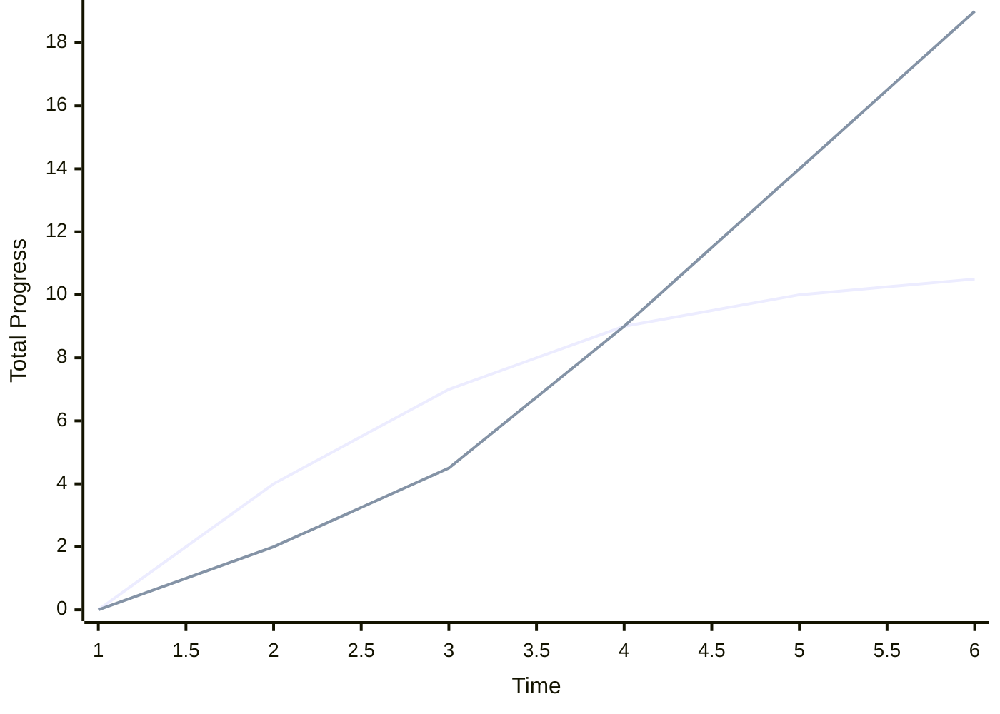

# Capítulo 3 — Código Funcional Não É Suficiente

*(Programação Estratégica vs. Tática)*

Um dos elementos mais importantes de um bom design de software é a mentalidade que você adota ao abordar uma tarefa de programação. Muitas organizações encorajam uma mentalidade tática, focada em fazer as funcionalidades funcionarem o mais rápido possível. No entanto, se você deseja um bom design, deve adotar uma abordagem mais estratégica, na qual investe tempo para produzir designs limpos e corrigir problemas. Este capítulo discute por que a abordagem estratégica produz designs melhores e é, na verdade, mais barata do que a abordagem tática a longo prazo.

## 3.1 Programação tática

A maioria dos programadores aborda o desenvolvimento de software com uma mentalidade que chamo de programação tática. Na abordagem tática, seu foco principal é fazer algo funcionar, como uma nova funcionalidade ou a correção de um bug. À primeira vista, isso parece totalmente razoável: o que poderia ser mais importante do que escrever um código que funciona? No entanto, a programação tática torna quase impossível produzir um bom design de sistema.

O problema da programação tática é que ela é imediatista. Se você está programando de forma tática, está tentando terminar uma tarefa o mais rápido possível. Talvez você tenha um prazo apertado. Como resultado, planejar para o futuro não é uma prioridade. Você não gasta muito tempo procurando o melhor design; você só quer que algo funcione logo. Você diz a si mesmo que não tem problema adicionar um pouco de complexidade ou introduzir uma ou duas pequenas gambiarras, desde que isso permita que a tarefa atual seja concluída mais rapidamente.

É assim que os sistemas se tornam complicados. Como discutido no capítulo anterior, a complexidade é incremental. Não é uma coisa específica que torna um sistema complicado, mas sim o acúmulo de dezenas ou centenas de pequenas coisas. Se você programa de forma tática, cada tarefa de programação contribuirá com algumas dessas complexidades. Provavelmente, cada uma delas parece um meio-termo razoável para terminar a tarefa atual rapidamente. No entanto, as complexidades se acumulam velozmente, especialmente se todos estiverem programando de forma tática.

Em pouco tempo, algumas dessas complexidades começarão a causar problemas, e você começará a desejar não ter tomado aqueles atalhos iniciais. Mas você dirá a si mesmo que é mais importante fazer a próxima funcionalidade rodar do que voltar e refatorar o código existente. A refatoração pode ajudar a longo prazo, mas definitivamente atrasará a tarefa atual. Então, você procura soluções paliativas rápidas para contornar os problemas que encontra. Isso apenas cria mais complexidade, o que, por sua vez, exige mais remendos. Em muito pouco tempo o código vira uma bagunça, mas a essa altura as coisas estão tão ruins que levariam meses de trabalho para serem limpas. Não há como o seu cronograma tolerar esse tipo de atraso, e corrigir um ou dois dos problemas não parece que fará muita diferença, então você simplesmente continua programando de forma tática.

Se você já trabalhou em um grande projeto de software por muito tempo, suspeito que já tenha visto a programação tática em ação e experimentado os problemas que ela resulta. Uma vez que você segue pelo caminho tático, é difícil mudar.

Quase toda organização de desenvolvimento de software tem pelo menos um desenvolvedor que leva a programação tática ao extremo: um tornado tático. O tornado tático é um programador prolífico que produz código muito mais rápido do que os outros, mas trabalha de forma totalmente tática. Quando se trata de implementar uma funcionalidade rápida, ninguém faz isso mais rápido do que o tornado tático. Em algumas organizações, a gerência trata os tornados táticos como heróis. No entanto, os tornados táticos deixam um rastro de destruição por onde passam. Eles raramente são considerados heróis pelos engenheiros que precisarão trabalhar com o código deles no futuro. Normalmente, os outros engenheiros precisam limpar a bagunça deixada pelo tornado tático, o que faz parecer que esses engenheiros (que são os verdadeiros heróis) estão progredindo mais lentamente do que o tornado tático.

> **N.T. (Nota do Tradutor):** O termo original "kludge" foi adaptado para "gambiarra", e "patches" para "remendos" ou "soluções paliativas", expressões muito mais naturais no dia a dia do desenvolvedor brasileiro para descrever soluções de código mal estruturadas ou feitas às pressas.

## 3.2 Programação estratégica

O primeiro passo para se tornar um bom designer de software é perceber que código que funciona não é o suficiente. Não é aceitável introduzir complexidades desnecessárias com o objetivo de terminar a sua tarefa atual mais rápido. A coisa mais importante é a estrutura de longo prazo do sistema. A maior parte do código em qualquer sistema é escrita estendendo a base de código existente, então o seu trabalho mais importante como desenvolvedor é facilitar essas extensões futuras. Sendo assim, você não deve pensar em "código que funciona" como seu objetivo principal, embora, é claro, seu código precise funcionar. Seu objetivo principal deve ser produzir um excelente design, que por acaso também funciona. Isso é a programação estratégica.

A programação estratégica exige uma mentalidade de investimento. Em vez de pegar o caminho mais rápido para terminar o seu projeto atual, você deve investir tempo para melhorar o design do sistema. Esses investimentos vão atrasá-lo um pouco no curto prazo, mas vão acelerar o seu trabalho no longo prazo, conforme ilustrado na Figura 3.1.

Alguns dos investimentos serão proativos. Por exemplo, vale a pena dedicar um tempo extra para encontrar um design simples para cada nova classe; em vez de implementar a primeira ideia que vier à mente, tente algumas alternativas de design e escolha a mais limpa. Tente imaginar algumas maneiras pelas quais o sistema possa precisar ser alterado no futuro e certifique-se de que isso será fácil com o seu design. Escrever uma boa documentação é outro exemplo de investimento proativo.

Outros investimentos serão reativos. Não importa o quanto você invista de antemão, inevitavelmente haverá erros nas suas decisões de design. Com o tempo, esses erros se tornarão óbvios. Quando você descobrir um problema de design, não o ignore nem aplique apenas um remendo; dedique um tempo extra para consertá-lo. Se você programar estrategicamente, fará pequenas melhorias contínuas no design do sistema. Isso é o oposto da programação tática, onde você adiciona continuamente pequenos pedaços de complexidade que causarão problemas no futuro.

## 3.3 Quanto investir?

Então, qual é a quantidade certa de investimento? Um investimento inicial gigantesco, como tentar projetar o sistema inteiro, não será eficaz. Esse é o método cascata (*waterfall*), e sabemos que ele não funciona. O design ideal tende a surgir aos poucos, à medida que você ganha experiência com o sistema. Sendo assim, a melhor abordagem é fazer vários pequenos investimentos de forma contínua. Sugiro gastar cerca de 10 a 20% do seu tempo total de desenvolvimento em investimentos. Essa quantia é pequena o suficiente para não impactar seus cronogramas de forma drástica, mas grande o bastante para produzir benefícios significativos ao longo do tempo.

Seus projetos iniciais, portanto, levarão de 10 a 20% mais tempo do que levariam em uma abordagem puramente tática. Esse tempo extra resultará em um design de software melhor, e você começará a colher os benefícios dentro de alguns meses. Não vai demorar muito para que você esteja desenvolvendo pelo menos 10 a 20% mais rápido do que estaria se tivesse programado de forma tática. Neste ponto, seus investimentos se tornam gratuitos: os benefícios dos seus investimentos passados vão economizar tempo suficiente para cobrir o custo dos investimentos futuros. Você recuperará rapidamente o custo do investimento inicial. A Figura 3.1 ilustra esse fenômeno.

**Figura 3.1:** No começo, uma abordagem tática de programação fará progressos mais rapidamente do que uma abordagem estratégica. No entanto, a complexidade se acumula de forma mais rápida sob a abordagem tática, o que reduz a produtividade. Com o tempo, a abordagem estratégica resulta em um progresso maior. Nota: esta figura tem o propósito apenas de ser uma ilustração qualitativa; não tenho conhecimento de nenhuma medição empírica sobre o formato exato das curvas.

Por outro lado, se você programar de forma tática, concluirá seus primeiros projetos 10 a 20% mais rápido, mas, com o tempo, sua velocidade de desenvolvimento vai diminuir conforme a complexidade se acumula. Logo você estará programando pelo menos 10 a 20% mais devagar. Você vai devolver rapidamente todo o tempo que economizou no início e, durante o resto da vida útil do sistema, estará desenvolvendo mais lentamente do que se tivesse adotado a abordagem estratégica. Se você nunca trabalhou em uma base de código muito degradada, converse com alguém que já passou por isso; eles dirão a você que a baixa qualidade do código atrasa o desenvolvimento em pelo menos 20%.

O termo *dívida técnica* é frequentemente usado para descrever os problemas causados pela programação tática. Ao programar taticamente, você está pegando tempo emprestado do futuro: o desenvolvimento andará mais rápido agora, mas mais lentamente depois. Assim como em uma dívida financeira, o valor que você devolve excederá o que você pegou emprestado. Diferente da dívida financeira, a maior parte da dívida técnica nunca é totalmente quitada: você continuará pagando e pagando para sempre.

A Figura 3.1 levanta uma questão importante: onde fica o ponto de cruzamento entre as curvas estratégica e tática? Em outras palavras, quanto tempo leva até que a abordagem estratégica se pague? Infelizmente, não conheço nenhum dado sobre esse assunto, e seria difícil realizar o tipo de experimento controlado necessário para responder a essa pergunta de forma convincente. Minha opinião pessoal é que o tempo de retorno fica na faixa de 6 a 18 meses. Isso tem muito a ver com a memória dos desenvolvedores: quando um trecho de código completa alguns meses, os desenvolvedores já esqueceram grande parte do que tinham em mente ao escrevê-lo, então o desenvolvimento vai desacelerar consideravelmente se o código for complexo. Esses custos adicionais compensam rapidamente qualquer ganho inicial da programação estratégica. Novamente, essa é apenas a minha opinião, e não tenho nenhum dado para comprová-la.

*(N.T.: No último parágrafo, o autor original escreveu "initial gains from strategic programming". Considerando o contexto da obra — que aponta a abordagem tática como a que fornece ganhos de velocidade no início —, é altamente provável que tenha ocorrido um lapso de revisão no idioma original. A tradução foi mantida em "programação estratégica" para preservar a integridade e literalidade documental do material original fornecido. Adicionalmente, os eixos e dados do gráfico Mermaid foram transcritos com suas nomenclaturas originais em inglês por limitações da sintaxe na representação visual exata, correspondendo respectivamente a: Eixo Y = Progresso Total / Eixo X = Tempo / Curvas = Estratégica e Tática).*

## 3.4 Startups e investimento

Em alguns ambientes, existem forças poderosas agindo contra a abordagem estratégica. Por exemplo, startups em estágio inicial sofrem uma pressão imensa para lançar suas primeiras versões rapidamente. Nessas empresas, pode parecer que até mesmo um investimento de 10 a 20% do tempo seja algo fora da realidade. Como resultado, muitas startups adotam uma abordagem tática, dedicando pouco esforço ao design e menos ainda à limpeza do código quando os problemas começam a surgir. Elas racionalizam isso com o pensamento de que, se tiverem sucesso, terão dinheiro suficiente para contratar engenheiros extras e arrumar a casa.

Se você está em uma empresa que se inclina para essa direção, deve ter em mente que, uma vez que a base de código vira um "código espaguete", é quase impossível consertar. Você provavelmente pagará altos custos de desenvolvimento por toda a vida útil do produto. Além disso, o retorno de um design bom (ou ruim) vem bem rápido, então há uma boa chance de que a abordagem tática sequer acelere o lançamento do seu primeiro produto.

Outro ponto a se considerar é que um dos fatores mais importantes para o sucesso de uma empresa é a qualidade de seus engenheiros. A melhor maneira de reduzir os custos de desenvolvimento é contratar excelentes engenheiros: eles não custam muito mais do que profissionais medianos, mas entregam uma produtividade absurdamente maior. No entanto, os melhores engenheiros se importam profundamente com um bom design. Se a sua base de código for um desastre, os boatos vão se espalhar, e isso tornará o seu processo de recrutamento mais difícil. Como resultado, é provável que você acabe contratando engenheiros medíocres. Isso aumentará seus custos futuros e provavelmente fará com que a estrutura do sistema se degrade ainda mais.

O Facebook é um exemplo de startup que incentivava a programação tática. Por muitos anos, o lema da empresa foi "Mova-se rápido e quebre as coisas" (*Move fast and break things*). Engenheiros recém-formados eram encorajados a mergulhar de cabeça na base de código da empresa imediatamente; era normal que fizessem *commits* direto em produção logo na primeira semana de trabalho. Pelo lado positivo, o Facebook construiu a reputação de ser uma empresa que dava autonomia aos seus funcionários. Os engenheiros tinham uma liberdade tremenda, e havia poucas regras e restrições para atrapalhar seu caminho.

O Facebook teve um sucesso espetacular como empresa, mas sua base de código sofreu por causa dessa abordagem tática; grande parte do código era instável e difícil de entender, com poucos comentários ou testes, e trabalhar com ele era um tormento. Com o tempo, a empresa percebeu que essa cultura era insustentável. Posteriormente, o Facebook mudou seu lema para "Mova-se rápido com uma infraestrutura sólida" para incentivar seus engenheiros a investir mais em um bom design. Resta saber se o Facebook conseguirá, de fato, limpar os problemas que se acumularam ao longo de anos de programação tática.

Para ser justo com o Facebook, devo ressaltar que o código deles provavelmente não é muito pior do que a média das startups. A programação tática é algo comum nesse meio; o Facebook é apenas um exemplo particularmente visível.

Felizmente, também é possível ter sucesso no Vale do Silício adotando uma abordagem estratégica. O Google e a VMware cresceram mais ou menos na mesma época que o Facebook, mas ambas as empresas abraçaram uma visão mais estratégica. As duas deram grande ênfase a códigos de alta qualidade e a um bom design, construindo produtos sofisticados que resolviam problemas complexos utilizando sistemas de software confiáveis. As fortes culturas técnicas dessas empresas tornaram-se muito conhecidas no Vale do Silício. Poucas outras conseguiam competir com elas na contratação dos melhores talentos da área.

Esses exemplos mostram que uma empresa pode ter sucesso com qualquer uma das duas abordagens. No entanto, é muito mais divertido trabalhar em uma empresa que se importa com o design de software e possui uma base de código limpa.

---

**Notas do Tradutor (N.T.):**

* **Design:** No contexto da engenharia de software (como abordado no texto), a palavra "design" não se refere à interface visual, mas sim à arquitetura, ao projeto e à estruturação do código em si.
* **Código espaguete (*spaghetti code*):** Expressão amplamente usada na área de tecnologia no Brasil para descrever um código-fonte mal estruturado, complexo, sem padrão e extremamente difícil de ser mantido ou compreendido.

## 3.5 Conclusão

Um bom design não vem de graça. Precisa ser algo no qual você investe continuamente, para que pequenos problemas não se acumulem e se tornem grandes.

Felizmente, um bom design acaba se pagando, e mais cedo do que você imagina.

É crucial ter consistência ao aplicar a abordagem estratégica e pensar no investimento como algo a ser feito hoje, e não amanhã. Quando você entrar em um período de pressão, será tentador adiar as limpezas e ajustes até que o aperto acabe. No entanto, esse é um terreno escorregadio; depois da crise atual, quase com certeza virá outra, e mais outra em seguida. Uma vez que você começa a adiar as melhorias de design, é fácil que esses atrasos se tornem permanentes e que a cultura da sua equipe acabe escorregando para uma abordagem puramente tática. Quanto mais você espera para resolver os problemas de design, maiores eles ficam; as soluções se tornam mais intimidadoras, o que torna ainda mais fácil continuar adiando tudo. A abordagem mais eficaz é aquela em que cada engenheiro faz pequenos e contínuos investimentos em um bom design.
