# Capítulo 7 — Camada Diferente, Abstração Diferente

Os sistemas de software são compostos por camadas, onde as camadas superiores utilizam os recursos fornecidos pelas camadas inferiores. Em um sistema bem projetado, cada camada fornece uma abstração diferente das camadas acima e abaixo dela; se você acompanhar uma única operação à medida que ela sobe e desce pelas camadas através da invocação de métodos, as abstrações mudam a cada chamada de método. Por exemplo:

- Em um sistema de arquivos, a camada mais alta implementa a abstração de um arquivo. Um arquivo consiste em um array de bytes de tamanho variável, que pode ser atualizado lendo e gravando intervalos de bytes também de tamanho variável. A próxima camada inferior no sistema de arquivos implementa um cache em memória de blocos de disco de tamanho fixo; os chamadores podem presumir que os blocos usados com frequência permanecerão na memória, onde poderão ser acessados rapidamente. A camada mais baixa é composta por drivers de dispositivo, que movem os blocos entre os dispositivos de armazenamento secundário e a memória.
- Em um protocolo de transporte de rede como o TCP, a abstração fornecida pela camada mais alta é um fluxo de bytes entregue de forma confiável de uma máquina para outra. Esse nível é construído sobre um nível inferior que transmite pacotes de tamanho limitado entre as máquinas sob um modelo de melhor esforço (best-effort): a maioria dos pacotes será entregue com sucesso, mas alguns podem ser perdidos ou entregues fora de ordem.

Se um sistema contém camadas adjacentes com abstrações semelhantes, isso é um sinal de alerta (red flag) que sugere um problema na decomposição de classes. Este capítulo discute as situações em que isso acontece, os problemas resultantes e como refatorar para eliminar esses problemas.

## 7.1 Métodos de repasse

Quando camadas adjacentes têm abstrações semelhantes, o problema frequentemente se manifesta na forma de métodos de repasse (pass-through methods). Um método de repasse é aquele que faz pouco além de invocar outro método, cuja assinatura é semelhante ou idêntica à do método que o chamou. Por exemplo, um projeto de estudante que implementava um editor de texto com interface gráfica (GUI) continha uma classe que consistia quase inteiramente de métodos de repasse. Aqui está um trecho dessa classe:

```java
public class TextDocument ... {
    private TextArea textArea;
    private TextDocumentListener listener;

    ...
    public Character getLastTypedCharacter() {
        return textArea.getLastTypedCharacter();
    }
    public int getCursorOffset() {
        return textArea.getCursorOffset();
    }
    public void insertString(String textToInsert,
                             int offset) {
        textArea.insertString(textToInsert, offset);
    }
    public void willInsertString(String stringToInsert,
                                 int offset) {
        if (listener != null) {
            listener.willInsertString(this, stringToInsert, offset);
        }
    }
    ...
}
```

> **🚩 Sinal de Alerta: Método de Repasse 🚩**
>
> Um método de repasse é aquele que não faz nada além de passar seus argumentos para outro método, geralmente com a mesma API do método de repasse. Isso normalmente indica que não há uma divisão clara de responsabilidade entre as classes.

13 dos 15 métodos públicos daquela classe eram métodos de repasse.

Métodos de repasse tornam as classes mais rasas: eles aumentam a complexidade da interface da classe, o que adiciona complexidade, mas não aumentam a funcionalidade total do sistema. Dos quatro métodos acima, apenas o último tem alguma funcionalidade, e mesmo assim ela é trivial: o método verifica a validade de uma variável. Métodos de repasse também criam dependências entre as classes: se a assinatura do método `insertString` mudar em `TextArea`, então o método `insertString` em `TextDocument` terá que mudar para corresponder a ela.

Métodos de repasse indicam que há confusão sobre a divisão de responsabilidade entre as classes. No exemplo acima, a classe `TextDocument` oferece um método `insertString`, mas a funcionalidade para inserir texto é totalmente implementada em `TextArea`. Isso geralmente é uma má ideia: a interface de uma funcionalidade deve estar na mesma classe que implementa a funcionalidade. Quando você vir métodos de repasse de uma classe para outra, considere as duas classes e pergunte a si mesmo: "Exatamente por quais recursos e abstrações cada uma dessas classes é responsável?". Você provavelmente notará que há uma sobreposição de responsabilidade entre as classes.

A solução é refatorar as classes para que cada uma tenha um conjunto distinto e coerente de responsabilidades. A Figura 7.1 ilustra várias maneiras de fazer isso. Uma abordagem, mostrada na Figura 7.1(b), é expor a classe de nível inferior diretamente aos chamadores da classe de nível superior, removendo toda a responsabilidade pelo recurso da classe de nível superior. Outra abordagem é redistribuir a funcionalidade entre as classes, como na Figura 7.1(c). Por fim, se as classes não puderem ser desembaraçadas, a melhor solução pode ser mesclá-las, como na Figura 7.1(d).

No exemplo acima, havia três classes com responsabilidades entrelaçadas: `TextDocument`, `TextArea` e `TextDocumentListener`. O estudante eliminou os métodos de repasse movendo os métodos entre as classes e condensando as três classes em apenas duas, cujas responsabilidades ficaram mais claramente diferenciadas.

> **Nota do Tradutor (N.T.):** O termo *shallow classes* (traduzido como "classes mais rasas") refere-se ao conceito popularizado por John Ousterhout no qual uma classe possui uma interface complexa, mas oferece pouca funcionalidade (pouca "profundidade"), sendo considerada um antipadrão de design de software.

## 7.2 Quando a duplicação de interface é aceitável?

Ter métodos com a mesma assinatura nem sempre é ruim. O importante é que cada novo método contribua com uma funcionalidade significativa. Métodos de repasse (*pass-through*) são ruins porque não agregam nenhuma funcionalidade nova.

Um exemplo em que é útil que um método chame outro com a mesma assinatura é um *dispatcher*. Um *dispatcher* é um método que usa seus argumentos para selecionar um dentre vários outros métodos para invocar; em seguida, ele repassa a maioria ou todos os seus argumentos para o método escolhido. A assinatura do *dispatcher* costuma ser a mesma dos métodos que ele chama.

Ainda assim, o *dispatcher* fornece uma funcionalidade útil: ele escolhe qual, dentre vários outros métodos, deve executar cada tarefa.

```mermaid
flowchart TD
    subgraph Cenário_A ["(a) C1 com métodos de repasse para C2"]
        direction TB
        inA1(( )) --> a_C1_M1[Quadrado]
        inA2(( )) --> a_C1_M2[Estrela]
        inA3(( )) --> a_C1_M3[Círculo]
        inA4(( )) --> a_C1_M4[Pentágono]

        a_C1_M2 --> a_C2_M2[Estrela]
        a_C1_M3 --> a_C2_M3[Círculo]
        a_C1_M4 --> a_C2_M4[Pentágono]
        a_C2_M5[Símbolo 4 pontas]
    end

    subgraph Cenário_B ["(b) Invocação direta a C2"]
        direction TB
        inB1(( )) --> b_C1_M1[Quadrado]
        inB2(( )) --> b_C2_M2[Estrela]
        inB3(( )) --> b_C2_M3[Círculo]
        inB4(( )) --> b_C2_M4[Pentágono]
        inB5(( )) --> b_C2_M5[Símbolo 4 pontas]
    end

    subgraph Cenário_C ["(c) Redistribuição de funcionalidade"]
        direction TB
        inC1(( )) --> c_C1_M1[Quadrado]
        inC2(( )) --> c_C1_M2[Estrela]
        inC3(( )) --> c_C2_M3[Círculo]
        inC4(( )) --> c_C2_M4[Pentágono]
        inC5(( )) --> c_C2_M5[Símbolo 4 pontas]
    end

    subgraph Cenário_D ["(d) Combinação das classes"]
        direction TB
        inD1(( )) --> d_C1_M1[Quadrado]
        inD2(( )) --> d_C1_M2[Estrela]
        inD3(( )) --> d_C1_M3[Círculo]
        inD4(( )) --> d_C1_M4[Pentágono]
        inD5(( )) --> d_C1_M5[Símbolo 4 pontas]
    end
```



**Figura 7.1:** Métodos de repasse (*pass-through*). Em (a), a classe C1 contém três métodos de repasse, que não fazem nada além de invocar métodos com a mesma assinatura em C2 (cada símbolo representa uma assinatura de método específica). Os métodos de repasse podem ser eliminados fazendo com que os chamadores de C1 invoquem C2 diretamente, como em (b), redistribuindo a funcionalidade entre C1 e C2 para evitar chamadas entre as classes, como em (c), ou combinando as classes, como em (d).

Por exemplo, quando um servidor Web recebe uma requisição HTTP de entrada de um navegador, ele invoca um *dispatcher* que examina a URL na requisição recebida e seleciona um método específico para tratá-la. Algumas URLs podem ser tratadas retornando o conteúdo de um arquivo no disco; outras podem ser tratadas invocando um procedimento em uma linguagem como PHP ou JavaScript. O processo de despacho pode ser bastante complexo e geralmente é guiado por um conjunto de regras que são comparadas com a URL recebida.

Não há problema em vários métodos terem a mesma assinatura, desde que cada um deles forneça uma funcionalidade útil e distinta. Os métodos invocados por um *dispatcher* possuem essa propriedade. Outro exemplo são interfaces com múltiplas implementações, como *drivers* de disco em um sistema operacional. Cada *driver* fornece suporte para um tipo diferente de disco, mas todos eles têm a mesma interface. Quando vários métodos fornecem diferentes implementações da mesma interface, isso reduz a carga cognitiva. Depois de trabalhar com um desses métodos, fica mais fácil trabalhar com os outros, já que você não precisa aprender uma nova interface. Métodos como esse geralmente estão na mesma camada e não invocam uns aos outros.

> **Nota do Tradutor (N.T.):** O termo *dispatcher* foi mantido no original em inglês, pois é amplamente consolidado na literatura e no mercado de engenharia de software no Brasil para designar um controlador/despachante de requisições. A expressão *pass-through* foi adaptada para "repasse", mantendo a referência original para clareza técnica.

## 7.3 Decorators

O padrão de projeto decorator (também conhecido como "wrapper") é aquele que encoraja a duplicação de APIs através das camadas. Um objeto decorator recebe um objeto existente e estende a sua funcionalidade; ele fornece uma API semelhante ou idêntica à do objeto subjacente, e seus métodos invocam os métodos desse objeto subjacente. No exemplo de I/O do Java do Capítulo 4, a classe `BufferedInputStream` é um decorator: dado um objeto `InputStream`, ela fornece a mesma API, mas introduz o uso de buffer. Por exemplo, quando seu método `read` é invocado para ler um único caractere, ele invoca o `read` no `InputStream` subjacente para ler um bloco muito maior e salva os caracteres extras para satisfazer chamadas futuras do `read`. Outro exemplo ocorre em sistemas de janelas: uma classe `Window` implementa uma forma simples de janela que não possui rolagem, e uma classe `ScrollableWindow` decora a classe `Window` adicionando barras de rolagem horizontais e verticais.

A motivação para o uso de decorators é separar extensões de propósito específico de uma classe a partir de um núcleo mais genérico. No entanto, as classes decorator tendem a ser rasas: elas introduzem uma grande quantidade de código repetitivo (boilerplate) para uma pequena quantidade de nova funcionalidade. Classes decorator costumam conter muitos métodos de repasse (pass-through). É fácil usar o padrão decorator em excesso, criando uma nova classe para cada pequeno novo recurso. Isso resulta em uma explosão de classes rasas, como no exemplo de I/O do Java.

Antes de criar uma classe decorator, considere alternativas como as seguintes:

- Você poderia adicionar a nova funcionalidade diretamente à classe subjacente, em vez de criar uma classe decorator? Isso faz sentido se a nova funcionalidade for de propósito relativamente geral, ou se estiver logicamente relacionada à classe subjacente, ou se a maioria dos usos da classe subjacente também for usar a nova funcionalidade. Por exemplo, praticamente todo mundo que cria um `InputStream` no Java também cria um `BufferedInputStream`, e o uso de buffer é uma parte natural de I/O, então essas classes deveriam ter sido combinadas.
- Se a nova funcionalidade for especializada para um caso de uso específico, faria sentido mesclá-la com o caso de uso, em vez de criar uma classe separada?
- Você poderia mesclar a nova funcionalidade com um decorator existente, em vez de criar um novo decorator? Isso resultaria em uma única classe decorator mais profunda em vez de várias rasas.
- Por fim, pergunte a si mesmo se a nova funcionalidade realmente precisa envolver (wrap) a funcionalidade existente: você poderia implementá-la como uma classe independente que seja separada da classe base? No exemplo do sistema de janelas, as barras de rolagem provavelmente poderiam ser implementadas separadamente da janela principal, sem envolver toda a sua funcionalidade existente.

Ocasionalmente, existem situações em que os wrappers fazem sentido. Um exemplo é quando um sistema usa uma classe externa cuja interface não pode ser modificada, mas a classe precisa estar em conformidade com uma interface diferente na aplicação onde está sendo usada. Nesse caso, uma classe wrapper pode ser usada para traduzir entre as interfaces. No entanto, situações como essa são raras; geralmente há uma alternativa melhor do que usar uma classe wrapper.

> **Nota do Tradutor (N.T.):** Termos técnicos de engenharia de software como "wrapper", "boilerplate", "pass-through" e "buffer" foram mantidos no original em inglês ou contextualizados entre parênteses, pois são amplamente utilizados no dia a dia e na literatura técnica pela comunidade brasileira de desenvolvimento.

## 7.4 Interface versus implementação

Outra aplicação da regra "camada diferente, abstração diferente" é que a interface de uma classe deve normalmente ser diferente da sua implementação: as representações usadas internamente devem ser diferentes das abstrações que aparecem na interface. Se as duas possuem abstrações semelhantes, então a classe provavelmente não é muito profunda. Por exemplo, no projeto do editor de texto discutido no Capítulo 6, a maioria das equipes implementou o módulo de texto em termos de linhas de texto, com cada linha armazenada separadamente. Algumas das equipes também projetaram as APIs para a classe de texto com base em linhas, com métodos como `getLine` e `putLine`. No entanto, isso tornou a classe de texto rasa e de uso desajeitado. No código de interface de usuário de nível mais alto, é comum inserir texto no meio de uma linha (por exemplo, quando o usuário está digitando) ou excluir um intervalo de texto que abrange várias linhas. Com uma API orientada a linhas para a classe de texto, os chamadores eram forçados a dividir e unir linhas para implementar as operações da interface de usuário. Esse código não era trivial, além de estar duplicado e espalhado por toda a implementação da interface de usuário.

As classes de texto se mostraram muito mais fáceis de usar quando forneciam uma interface orientada a caracteres, como um método `insert` que insere uma string arbitrária de texto (que pode incluir quebras de linha) em uma posição arbitrária no texto e um método `delete` que exclui o texto entre duas posições arbitrárias no texto. Internamente, o texto continuava sendo representado em termos de linhas. Uma interface orientada a caracteres encapsula a complexidade de dividir e unir linhas dentro da classe de texto, o que torna a classe de texto mais profunda e simplifica o código de nível mais alto que utiliza a classe. Com essa abordagem, a API de texto fica bem diferente do mecanismo de armazenamento orientado a linhas; a diferença representa uma funcionalidade valiosa fornecida pela classe.

> **Nota do Tradutor (N.T.):** No contexto de engenharia de software e arquitetura de sistemas, os termos "profunda" (*deep*) e "rasa" (*shallow*) referem-se aos conceitos popularizados por John Ousterhout. Uma classe "profunda" é aquela que oferece uma interface simples, mas oculta uma implementação complexa. Uma classe "rasa" é aquela cuja interface é tão complexa quanto o seu funcionamento interno, não oferecendo grande vantagem de abstração para quem a utiliza. O termo "chamadores" (*callers*) refere-se aos blocos de código ou funções que invocam os métodos dessa classe.

## 7.5 Variáveis de passagem

Outra forma de duplicação de API entre camadas é uma *variável de passagem* (*pass-through variable*), que é uma variável repassada para baixo por uma longa cadeia de métodos. A Figura 7.2(a) mostra um exemplo de um serviço de datacenter. Um argumento de linha de comando descreve os certificados a serem usados para comunicação segura. Essa informação só é necessária para um método de baixo nível `m3`, que chama um método de biblioteca para abrir um *socket*, mas ela é repassada por todos os métodos no caminho entre `main` e `m3`. A variável `cert` aparece na assinatura de cada um dos métodos intermediários.

Variáveis de passagem adicionam complexidade porque forçam todos os métodos intermediários a estarem cientes de sua existência, mesmo que esses métodos não tenham uso para elas. Além disso, se uma nova variável passar a existir (por exemplo, se um sistema é inicialmente construído sem suporte a certificados, mas depois você decide adicionar esse suporte), pode ser necessário modificar um grande número de interfaces e métodos para repassar a variável por todos os caminhos relevantes.

Eliminar variáveis de passagem pode ser desafiador. Uma abordagem é verificar se já existe um objeto compartilhado entre os métodos mais no topo e mais na base. No exemplo do serviço de datacenter da Figura 7.2, talvez exista um objeto contendo outras informações sobre a comunicação de rede, que esteja disponível tanto para `main` quanto para `m3`. Se sim, `main` pode armazenar as informações do certificado nesse objeto, para que ele não precise ser repassado por todos os métodos intermediários no caminho até `m3` (veja a Figura 7.2(b)). No entanto, se houver um objeto desse tipo, ele próprio pode acabar se tornando uma variável de passagem (de que outra forma `m3` teria acesso a ele?).

Outra abordagem é armazenar a informação em uma variável global, como na Figura 7.2(c). Isso evita a necessidade de passar a informação de método para método, mas variáveis globais quase sempre criam outros problemas. Por exemplo, variáveis globais tornam impossível criar duas instâncias independentes do mesmo sistema no mesmo processo, já que os acessos às variáveis globais entrarão em conflito. Pode parecer improvável que você precise de múltiplas instâncias em produção, mas elas costumam ser úteis em testes.

A solução que uso com mais frequência é introduzir um objeto de *contexto* (*context object*), como na Figura 7.2(d). Um contexto armazena todo o estado global da aplicação (qualquer coisa que, de outra forma, seria uma variável de passagem ou uma variável global). A maioria das aplicações possui múltiplas variáveis em seu estado global, representando coisas como opções de configuração, subsistemas compartilhados e contadores de desempenho. Existe um objeto de contexto por instância do sistema. O contexto permite que múltiplas instâncias do sistema coexistam em um único processo, cada uma com seu próprio contexto.

```text
(a)                               (b)
main(argc, argv)                  main(argc, argv)
   |                                 | .................
m1(... cert, ...)                 m1(...)              :
   |                                 |               [ x    ] objeto
m2(... cert, ...)                 m2(...)            [ y    ] compartilhado
   |                                 |               [ cert ]
m3(... cert, ...) {               m3(...) {            :
  ...                               ... ................
  openSocket(cert, ...)             openSocket(obj.cert, ...)
}                                 }


(c)                               (d)
main(argc, argv)                  main(argc, argv)
   | .......                         | .................
m1(...)    : variável             m1(...)              :
   |       : global                  |               [ timeout ] objeto de
m2(...)    :                      m2(...)            [ metrics ] contexto
   |       :                         |               [ cert    ]
m3(...) {  :                      m3(...) {            :
  ... ......                        ... ................
  openSocket(cert, ...)             openSocket(context.cert, ...)
}                                 }
```

**Figura 7.2:** Técnicas possíveis para lidar com uma variável de passagem. Em (a), `cert` é repassada pelos métodos `m1` e `m2`, mesmo que eles não a utilizem. Em (b), `main` e `m3` têm acesso compartilhado a um objeto, de modo que a variável pode ser armazenada lá em vez de ser repassada por `m1` e `m2`. Em (c), `cert` é armazenada como uma variável global. Em (d), `cert` é armazenada em um objeto de contexto juntamente com outras informações de todo o sistema, como um valor de tempo limite (*timeout*) e contadores de desempenho; uma referência ao contexto é armazenada em todos os objetos cujos métodos precisam de acesso a ele.

Infelizmente, o contexto provavelmente será necessário em muitos lugares, então ele pode se tornar, potencialmente, uma variável de passagem. Para reduzir o número de métodos que precisam estar cientes dele, uma referência ao contexto pode ser salva na maioria dos objetos principais do sistema. No exemplo da Figura 7.2(d), a classe que contém `m3` armazena uma referência ao contexto como uma variável de instância em seus objetos. Quando um novo objeto é criado, o método criador recupera a referência do contexto a partir de seu objeto e a passa para o construtor do novo objeto. Com essa abordagem, o contexto fica disponível em todos os lugares, mas aparece apenas como um argumento explícito nos construtores.

O objeto de contexto unifica o tratamento de todas as informações globais do sistema e elimina a necessidade de variáveis de passagem. Se uma nova variável precisar ser adicionada, ela pode ser incorporada ao objeto de contexto; nenhum código existente é afetado, exceto o construtor e o destrutor do contexto. O contexto facilita a identificação e o gerenciamento do estado global do sistema, já que tudo fica armazenado em um só lugar. O contexto também é conveniente para testes: o código de teste pode alterar a configuração global da aplicação modificando campos no contexto. Seria muito mais difícil implementar tais mudanças se o sistema usasse variáveis de passagem.

Contextos estão longe de ser uma solução ideal. As variáveis armazenadas em um contexto têm a maioria das desvantagens das variáveis globais; por exemplo, pode não ser óbvio o porquê de uma variável específica estar presente, ou onde ela é usada. Sem disciplina, um contexto pode se transformar em um enorme amontoado desorganizado de dados que cria dependências não óbvias por todo o sistema. Contextos também podem criar problemas de segurança de *thread* (*thread-safety*); a melhor maneira de evitar problemas é garantir que as variáveis em um contexto sejam imutáveis. Infelizmente, não encontrei uma solução melhor do que contextos.

---

> **Notas do Tradutor (N.T.):**
>
> - **Pass-through variables:** Traduzido como "variáveis de passagem". O termo refere-se ao ato de repassar um dado adiante em uma cadeia de execução sem utilizá-lo diretamente nas camadas intermediárias.
> - **Grab-bag:** Expressão traduzida como "amontoado desorganizado de dados" para manter o tom técnico, mas que no uso coloquial americano remete a um "saco de surpresas" ou "saco de gatos", indicando um lugar onde se joga de tudo sem critério.

## 7.6 Conclusão

Cada parte da infraestrutura de design adicionada a um sistema — como uma interface, argumento, função, classe ou definição — adiciona complexidade, já que os desenvolvedores precisam aprender sobre esse elemento. Para que um elemento proporcione um ganho líquido contra a complexidade, ele deve eliminar alguma complexidade que estaria presente na ausência desse elemento de design. Caso contrário, é melhor implementar o sistema sem aquele elemento em particular. Por exemplo, uma classe pode reduzir a complexidade ao encapsular funcionalidades, de modo que os usuários da classe não precisem ter conhecimento delas.

A regra de "camadas diferentes, abstrações diferentes" é apenas uma aplicação dessa ideia: se camadas diferentes possuem a mesma abstração, como métodos ou decorators de repasse, então há uma grande chance de que não tenham fornecido um benefício suficiente para compensar a infraestrutura adicional que representam. Da mesma forma, argumentos de repasse exigem que cada um dentre vários métodos esteja ciente de sua existência (o que aumenta a complexidade) sem contribuir com nenhuma funcionalidade adicional.

> **Nota do Tradutor (N.T.):**
>
> - **Pass-through methods / arguments:** Traduzido como "métodos/argumentos de repasse". Na prática de engenharia de software no Brasil, muitas vezes usa-se o jargão original. Refere-se a métodos ou parâmetros cuja única função é receber um dado e repassá-lo diretamente para outra função na cadeia de chamadas, sem aplicar nenhuma lógica própria.
> - **Decorators:** Mantido na forma original em inglês, pois é o termo universalmente adotado pelos desenvolvedores brasileiros para designar este padrão de projeto (especialmente comum em linguagens como Python e TypeScript).
